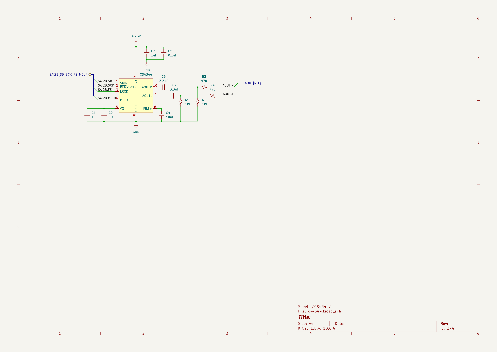
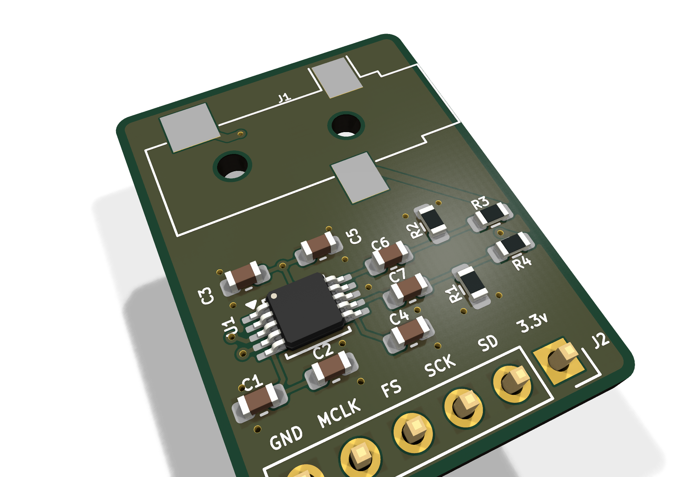
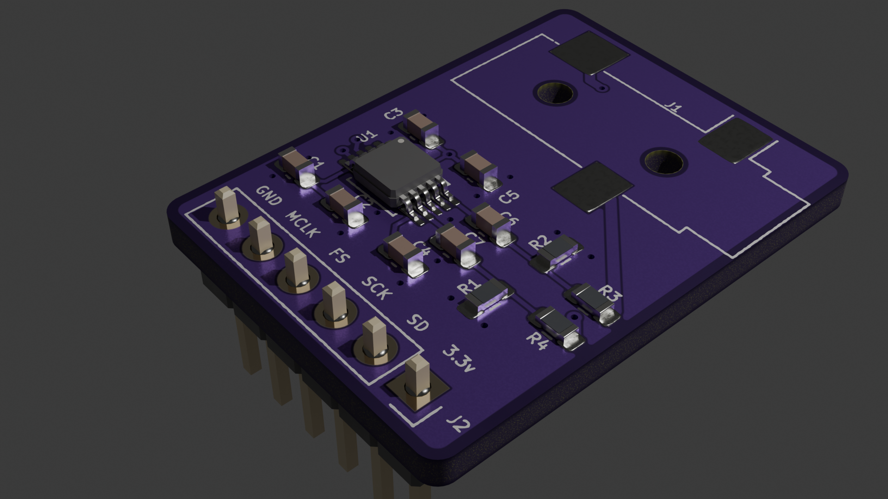
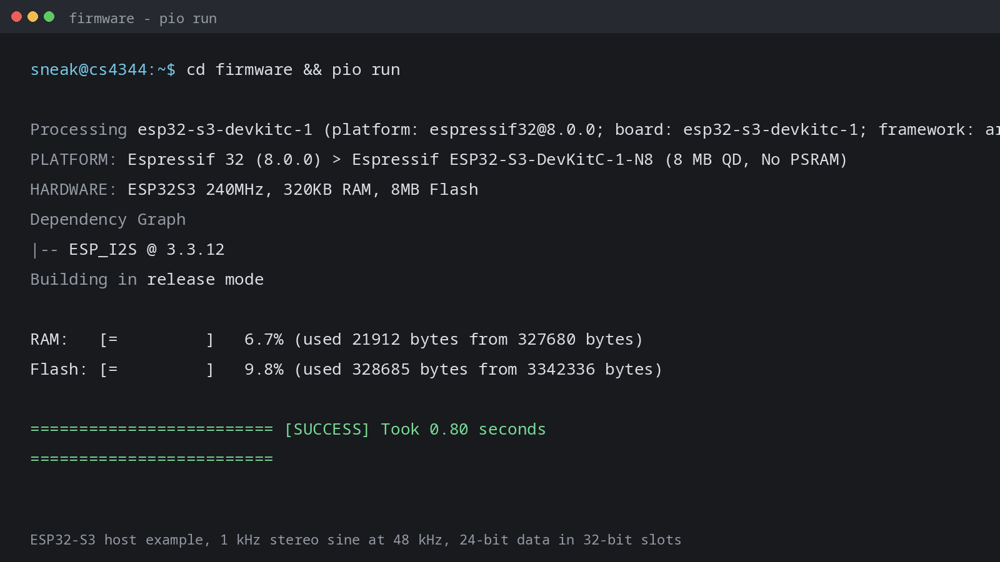

# October 24: Schematic and first layout

## What I did:

- Chose the CS4344 for a small I2S DAC board.
- Drew the hierarchical schematic with separate root, DAC, jack, and connector sheets.
- Picked the output network: 3.3 uF series caps, 470 ohm series resistors, and 10 k bleed resistors.
- Placed the DAC, passives, jack, and 6-pin header on an 18.5 x 25 mm board.
- Started routing the I2S and output nets.
- Ran ERC and fixed the pin and net issues.

## Why:

I wanted a reusable I2S DAC that does not need a codec driver. The CS4344 is hardware-mode, so the host only needs to send clocks and data. Splitting the schematic into sheets keeps the connector, DAC, and jack easy to read. The board is small because it is meant to sit next to an FPGA or microcontroller, not on a full audio board.

## Screenshots:

**Total time spent: 2 hours**

# October 25: Routing, 3D checks, and enclosure

## What I did:

- Finished routing both layers and cleaned up the silkscreen.
- Ran DRC. One warning remains on J1 because the board footprint differs from the KiCad library footprint; there are no DRC errors.
- Fixed the 3D models. The header model was rotated 180 degrees and offset by 1.5 mm, so it hung below the board. I switched to the socket model and zeroed the offset. The jack now uses the closest KiCad model because the exact SMT part is not in the library.
- Exported the Gerbers, drill files, BOM, positions, and STEP assembly.
- Designed a two-part enclosure in CadQuery with a jack opening, header slot, board ledges, and four M2 screw posts.
- Rendered the PCB and enclosure and wrote the README and BOM.

## Why:

The 3D assembly is only useful if the models line up with the real parts. The header fix mattered because the case lid sits right above it. I wanted a case that holds the board without mounting holes and still leaves the jack and header accessible. The enclosure is parametric so I can change the wall thickness or board position after a test print. The board and case are still untested, so I am not calling this finished.

## Screenshots:

**Total time spent: 2 hours**

# October 25: Host-side test firmware

## What I did:

- Wrote a PlatformIO example for an ESP32-S3-DevKitC-1 that sends a 1 kHz stereo sine to the DAC at 48 kHz.
- Added the MCLK, BCLK, LRCK, and data pin assignments and documented the wiring to J2.
- Used 32-bit I2S slots with the 24-bit samples left-aligned. The Arduino ESP_I2S wrapper fixes the MCLK multiple at 256, and the ESP-IDF clock setup rejects 24-bit slots with that multiple.
- Built the firmware cleanly. It uses 6.7% of RAM and 9.8% of flash.
- Added a firmware README, an MIT license, and a wiring table to the main README.
- Added PWR_FLAG symbols and a project power library mapping so the final ERC run passes with no errors or warnings.

## Why:

The board has no microcontroller, so it needs a host to generate the clocks and data. I wanted a test program that proves the I2S wiring and the analog output path before I connect the DAC to a larger FPGA project. The 32-bit slot setting is a workaround for the Arduino wrapper, not a DAC limitation. The firmware still has to run on a real board, so this is only a compile-time check for now.

## Screenshots:

**Total time spent: 2 hours**
