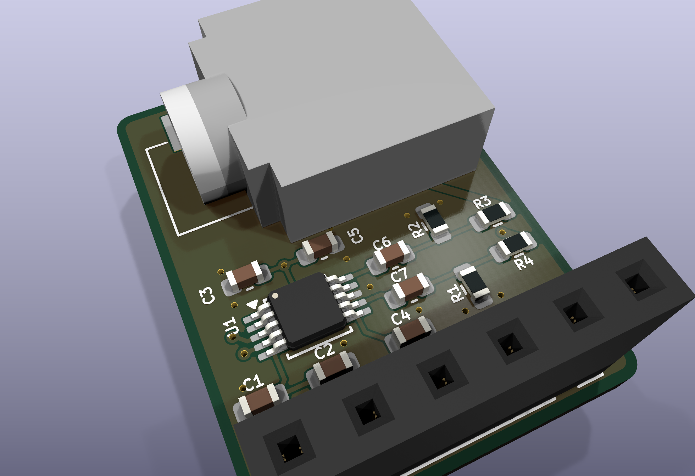
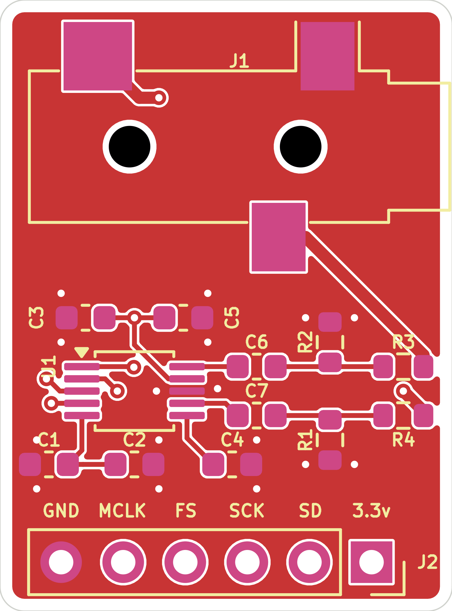
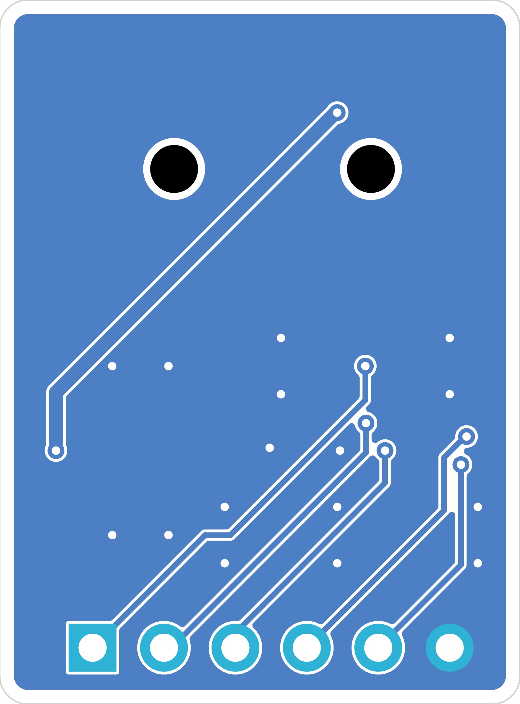
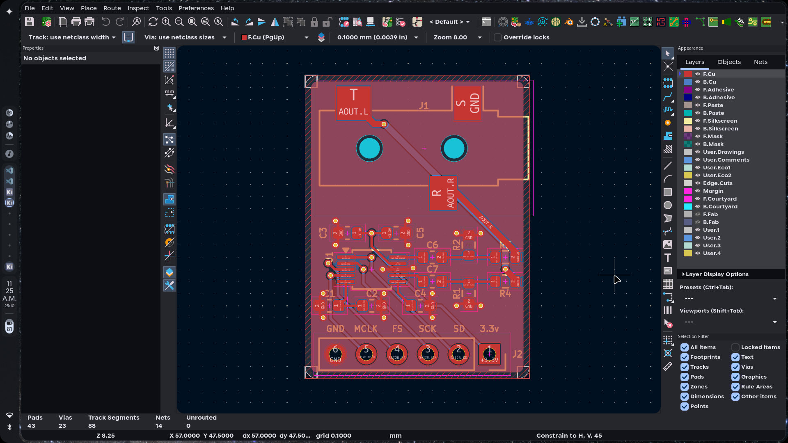
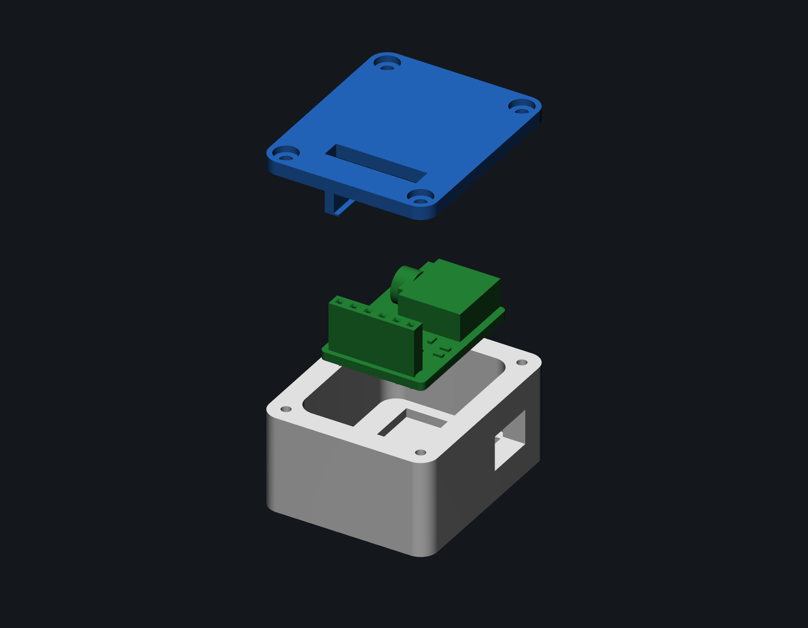

# CS4344 I2S DAC Breakout

**A compact 24-bit / 192 kHz stereo DAC for I2S audio projects.**

`SPDX-License-Identifier: CERN-OHL-P-2.0`



## Overview

The CS4344 is a 24-bit stereo DAC that accepts I2S audio and runs from a single 3.3 V supply. This board gives it a 6-pin 2.54 mm header, a 3.5 mm stereo jack, and the passives it needs. There is no configuration bus. The DAC is in hardware mode, so the host only has to provide clocks and data.

The PCB is 18.5 x 25.0 mm, two layers. The repository also includes a STEP assembly, a parametric 3D-printable case, and an ESP32-S3 test firmware example.

## Why I made this

I wanted a small, reusable I2S output board for FPGA and microcontroller projects.
The CS4344 is inexpensive, supports 24-bit / 192 kHz audio, and has a simple hardware interface.
The board has a real jack so it can be used outside a breadboard.

## Custom features

- 24-bit, up to 192 kHz stereo DAC.
- Hardware-mode I2S input. No I2C or SPI setup.
- Single 3.3 V supply.
- 6-pin 2.54 mm header for power and I2S.
- 3.5 mm stereo SMD jack.
- AC-coupled outputs with 3.3 uF series capacitors, 470 ohm series resistors, and 10 k bleed resistors.
- Compact 18.5 x 25.0 mm two-layer PCB.
- Two-part 3D-printable enclosure with a jack opening, header slot, and M2 screw posts.
- Full STEP assembly and parametric CadQuery source.

## How it works

The signal path is short: I2S comes in on J2, the CS4344 converts it, and the output network drives the jack.

| Block | Main parts | Function |
|---|---|---|
| I2S input | J2 | 3.3 V, ground, SD, SCK, FS, and MCLK |
| DAC | U1 | CS4344 stereo I2S DAC |
| Analog output | C6, C7, R1-R4, J1 | AC coupling, series resistance, and 3.5 mm output |
| Supply and reference decoupling | C1-C5 | VA, VQ, and FILT+ decoupling |

### Power tree

```text
J2.1  +3.3V ---+--- U1.9  VA
               |
               +--- C3 1 uF --- GND
               |
               +--- C5 100 nF --- GND

U1.5  VQ ------+--- C1 10 uF --- GND
               |
               +--- C2 100 nF --- GND

U1.6  FILT+ ---+--- C4 10 uF --- GND
```

The CS4344 is a 3.3 V part. Do not power the board from 5 V. VQ and FILT+ are internal reference/filter nodes; they are decoupled on the board and must not be driven from outside.

### I2S input

```text
J2.2  SD   -> U1.1  SDIN
J2.3  SCK  -> U1.2  SCLK
J2.4  FS   -> U1.3  LRCK
J2.5  MCLK -> U1.4  MCLK
```

The host must supply MCLK. There is no oscillator on the board. The CS4344 accepts several MCLK-to-FS ratios in hardware mode; check the datasheet for the ratio your host uses.

### Analog output

```text
U1.7  AOUTL -> C7 3.3 uF -> node L -> R4 470 ohm -> J1 tip
                              |
                              +-> R1 10 k -> GND

U1.10 AOUTR -> C6 3.3 uF -> node R -> R3 470 ohm -> J1 ring
                              |
                              +-> R2 10 k -> GND

J1 sleeve -> GND
```

Each output is AC-coupled so the DAC's DC bias does not appear at the jack. The 10 k resistor keeps the coupling capacitor's output node referenced to ground, and the 470 ohm resistor limits current into the cable. This is a line-level output, not a headphone amplifier. Use an external headphone amp or powered speakers if you need more drive.

## Schematic

The design is split into four KiCad sheets:

- [Root](images/schematic/01-root.png)
- [CS4344 and output network](images/schematic/02-cs4344.png)
- [3.5 mm jack](images/schematic/03-jack.png)
- [I2S header](images/schematic/04-connector.png)


## PCB design

- 18.5 x 25.0 mm board, 1.6 mm FR-4, two copper layers.
- 1 mm rounded corners.
- 0.2 mm signal traces, 0.5 mm output traces, 0.3 mm via drills.
- The board has no mounting holes.

| Top | Bottom |
|---|---|
|  |  |



More views:

- [Top 3D render](images/pcb/render-top.png)
- [Bottom 3D render](images/pcb/render-bottom.png)
- [Isometric 3D render](images/pcb/render-iso.png)

## Enclosure

The case is a two-part print: a base with screw posts and board ledges, and a lid with a header slot, registration lips, and a hold-down rib. The jack opening is on the right-hand wall. The lid is fixed with four M2 self-tapping screws. The outside size is 30 x 36 mm, 19.4 mm tall with the lid fitted and 20.8 mm including the screw heads.

| Assembled | Cutaway | Exploded |
|---|---|---|
|  |  |  |

The enclosure is parametric CadQuery. Edit the constants at the top of `cad/enclosure.py` and rerun the script to regenerate the STEP and STL files. The full board and case assembly is in `cad/CS4344-full-assembly.step`, and the board and electronics assembly is in `cad/CS4344-assembly.step`. It has not been printed or test-fitted yet.

Suggested print settings:

- 0.2 mm layer height
- 4 perimeters
- 20% infill
- PLA or PETG
- M2 x 8 mm self-tapping screws

## Usage

1. Connect 3.3 V to J2 pin 1 and ground to J2 pin 6.
2. Connect the host's I2S data, bit clock, and frame clock to SD, SCK, and FS.
3. Connect a master clock to MCLK. The board does not generate one.
4. Connect a 3.5 mm stereo cable from J1 to your amplifier or powered speakers.
5. Enable the I2S output on the host and start playback.

Use 3.3 V logic levels. The board does not include level shifters.

### Pinout

| J2 pin | Signal | Direction | Notes |
|---|---|---|---|
| 1 | +3.3V | Power in | 3.3 V only |
| 2 | SD | Input | I2S serial data |
| 3 | SCK | Input | I2S bit clock |
| 4 | FS | Input | I2S frame clock / LRCK |
| 5 | MCLK | Input | Master clock, required |
| 6 | GND | Power | Ground |

| J1 contact | Signal |
|---|---|
| Tip | Left channel |
| Ring | Right channel |
| Sleeve | Ground |

There is no firmware on the board. The host does all of the I2S setup. An ESP32-S3 test example is in `firmware/`.

## Firmware

The board has no MCU, so the firmware in `firmware/` runs on a host board. The example targets an ESP32-S3-DevKitC-1 and outputs a 1 kHz stereo sine at 48 kHz. It is meant as a bring-up test for the DAC and the analog output path.

`SPDX-License-Identifier: MIT`

| Signal | CS4344 J2 pin | ESP32-S3 pin |
|---|---|---|
| +3.3 V | 1 | 3V3 |
| SD | 2 | GPIO6 |
| SCK | 3 | GPIO4 |
| FS | 4 | GPIO5 |
| MCLK | 5 | GPIO7 |
| GND | 6 | GND |

The example runs I2S in standard mode with MCLK at 12.288 MHz, BCLK at 3.072 MHz, and LRCK at 48 kHz. It writes 24-bit samples left-aligned in 32-bit slots. The 32-bit slot keeps the 64 x Fs bit clock that the CS4344 expects. See [firmware/README.md](firmware/README.md) for the build, flash, and test steps.

```sh
cd firmware
pio run
pio run -t upload
pio device monitor
```

The example compiles but has not been run on a fabricated board yet.

## BOM

Prices are in USD and cover one set of electronics, the five-board JLCPCB minimum, and a 10-pack of M2 screws. Shipping, tax, and assembly fees are not included. The root [BOM.csv](BOM.csv) has a purchase link on every part line.

| Ref | Qty | Part | Package | Supplier | Part number | Unit price |
|---|---|---|---|---|---|---|
| U1 | 1 | CS4344-CZZR | TSSOP-10 | LCSC | C8952 | $1.5154 |
| J1 | 1 | SJ-3523-SMT-TR | SMD jack | Digi-Key | CP-3523SJCT-ND | $0.8800 |
| J2 | 1 | 1x6 2.54 mm female header | THT | LCSC | C40877 | $0.0889 |
| C1, C4 | 2 | 10 uF 10 V X5R | 0603 | LCSC | C19702 | $0.0272 |
| C2, C5 | 2 | 100 nF 50 V X7R | 0603 | LCSC | C14663 | $0.0084 |
| C3 | 1 | 1 uF 50 V X5R | 0603 | LCSC | C15849 | $0.0146 |
| C6, C7 | 2 | 3.3 uF 10 V X5R | 0603 | LCSC | C51412 | $0.0601 |
| R1, R2 | 2 | 10 k 1% | 0603 | LCSC | C25804 | $0.0022 |
| R3, R4 | 2 | 470 ohm 1% | 0603 | LCSC | C23179 | $0.0023 |
| PCB | 5 | CS4344 PCB | 18.5 x 25 mm | JLCPCB | - | $0.4000 |
| HW1 | 1 | M2 x 8 mm self-tapping screw, 10-pack | M2 | Motion RC | BCT5040-022 | $1.0900 |

| | |
|---|---:|
| Electronics subtotal | $2.6993 |
| 5 PCBs | $2.0000 |
| Screws, 10-pack | $1.0900 |
| **Total, excluding shipping and tax** | **$5.7893** |

That total buys one set of electronics, five bare PCBs, and a 10-pack of screws. You can build one board, keep four spare PCBs, and use 4 of the 10 screws.

The exact CUI jack is out of stock at LCSC. The Digi-Key part is the same SJ-3523-SMT-TR and was in stock when I checked.

## Production

Fabrication files are in `kicad/production/`:

- `CS4344.zip` - Gerbers and drill files.
- `bom.csv` - assembly BOM.
- `positions.csv` - pick-and-place positions.
- `designators.csv` - designator list.
- `netlist.ipc` - IPC netlist.

The board has not been ordered yet. The enclosure has not been printed yet.

## Repository structure

```text
CS4344/
|-- README.md
|-- JOURNAL.md
|-- BOM.csv
|-- LICENSE
|-- LICENSE-MIT
|-- .gitignore
|-- kicad/
|   |-- CS4344.kicad_pro
|   |-- CS4344.kicad_sch
|   |-- connector.kicad_sch
|   |-- cs4344.kicad_sch
|   |-- jack.kicad_sch
|   |-- CS4344.kicad_pcb
|   |-- sym-lib-table
|   |-- fabrication-toolkit-options.json
|   `-- production/
|       |-- CS4344.zip
|       |-- bom.csv
|       |-- designators.csv
|       |-- netlist.ipc
|       `-- positions.csv
|-- cad/
|   |-- enclosure.py
|   |-- CS4344-assembly.step
|   |-- CS4344-board.step
|   |-- CS4344-enclosure-base.step
|   |-- CS4344-enclosure-base.stl
|   |-- CS4344-enclosure-lid.step
|   |-- CS4344-enclosure-lid.stl
|   `-- CS4344-full-assembly.step
|-- firmware/
|   |-- README.md
|   |-- platformio.ini
|   `-- src/
|       `-- main.cpp
|-- images/
|   |-- schematic/       (screenshots as .png)
|   |-- pcb/             (editor screenshot)
|   |-- assembly/        (exploded)
|   `-- screenshots/     (timestamped progress images)
`-- blender/
    |-- CS4344.blend
    `-- CS4344.pcb3d
```

## Known issues

- The board has not been fabricated or tested. This is a first revision.
- The enclosure has not been printed or test-fitted.
- The lid counterbores are 4.2 mm across. Check the head diameter of the screws you buy and enlarge the counterbores if needed.
- The screws in the STEP assembly are simplified cylinders, not the exact screw geometry.
- The board has no mounting holes. It is held by the case ledges and lid rib.
- The CS4344 is TSSOP-10 with 0.5 mm pin pitch. It is not a good first hand-soldering project; use a stencil and hot air or reflow.
- The output is line level. It will not drive headphones directly.
- The ESP32-S3 firmware example compiles but has not been run on a fabricated board.

## Credits and inspiration

- Cirrus Logic for the CS4344 datasheet and reference circuit.
- KiCad for the schematic and PCB tools.
- CadQuery for the parametric enclosure.
- Hack Club Forge for the deadline and the push to document the project.

## License

Hardware design files and documentation are licensed under the CERN Open Hardware Licence Version 2 - Permissive (CERN-OHL-P-2.0). See [LICENSE](LICENSE).

`SPDX-License-Identifier: CERN-OHL-P-2.0`

The example firmware in `firmware/` is licensed under the MIT License. See [LICENSE-MIT](LICENSE-MIT).

`SPDX-License-Identifier: MIT`
